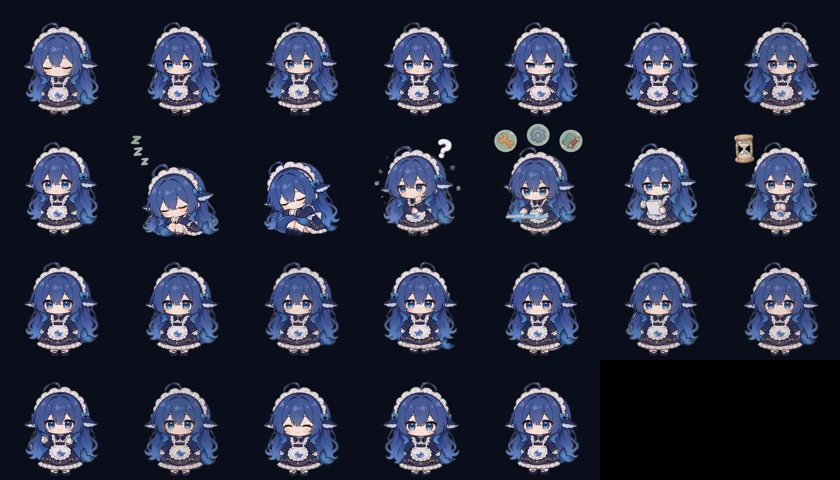

# dsh-pet-esp32

Bring the [DeepSeek Harness](https://github.com/deepseek-ai) desktop pet **dsh-pet**
to an **M5Stack Dial v1.1**: the blue-haired maid lives on the 240×240 round screen,
wanders through her animations on her own, and mirrors what DSH is doing over USB.

This is an unofficial port. All character art, animation clips and status lines come
from the original **[dsh-pet](https://github.com/PC2005-cloud/dsh-pet)** project by
**PC2005-cloud**, used under the MIT license — see [Credits](#credits--license).




## Features

- **26 animations / 559 frames / 4.8 MB** packed into flash as JPEG, decoded straight
  out of a memory-mapped partition at ~10 fps.
- **Auto mode** — idle breathing loop, with a random little action every 8–16 s.
- **Knob** — one click = next animation; a fast spin keeps switching (~25/s);
  reversing goes back; stopping stops. Auto resumes 20 s after you stop touching it.
- **Button / touch** — random "click response"; long press = sleep / wake.
- **DSH link** — the bridge mirrors `thinking / working / result / waiting / success /
  error` from dsh-pet and shows that plugin's own status lines (in Chinese, rendered
  with the pet's font at build time), with a matching colour ring.
- **No flicker** — ring and captions are composited into the same sprite as the frame
  and pushed in one go.

## Hardware

- M5Stack Dial v1.1: ESP32-S3FN8, 8 MB flash, **no PSRAM**, 1.28" GC9A01 round LCD,
  rotary encoder + button + capacitive touch.
- The firmware keeps Wi-Fi/BT off; USB power or the internal battery both work.

## Using it

| Input | Effect |
| --- | --- |
| Turn slowly | one click = next animation (auto returns after 20 s) |
| Turn fast | continuous switching, ~25 animations/s, stops when you stop |
| Reverse | goes back immediately |
| Short press / tap | random click response |
| Long press | sleep / wake |

The top shows `AUTO` / `MANUAL` / `SLEEP` / `DSH`; the bottom shows the current
animation, or the DSH status line while the bridge is connected.

## DSH bridge

dsh-pet already exposes a long-poll state endpoint; the bridge just reads it, so DSH
itself is untouched:

```powershell
node bridge\dsh-pet-dial-bridge.mjs --port COM5
```

- Auto-detects the device: probes every `VID_303A&PID_1001` port and asks for
  `INFO anims=`.
- Follows `sections.workStatus.data.state` and forwards it as `S <state>`.
- Falls back to standalone auto mode after 90 s of silence.
- Options: `--url http://127.0.0.1:52202` (defaults to `$env:DSH_WEB_URL`), `--pet main`.

Double-click `bridge\start-bridge.cmd` if you prefer a window to keep open.

## Build

```powershell
# 1) regenerate the animation blob (needs ffmpeg + Pillow + the dsh-pet assets)
python tools\build_assets.py

# 2) compile + flash (app, or app + assets)
pwsh -File tools\build.ps1
pwsh -File tools\build.ps1 -Assets
```

Toolchain: `arduino-cli` + `esp32:esp32@3.3.12` + M5Dial / M5Unified / M5GFX / JPEGDEC,
installed at `C:\dshdial` by default (override with `$env:DSH_DIAL_TOOLCHAIN`).
The short path is not cosmetic: GCC cannot open its own C++ headers once the install
path pushes past MAX_PATH.

Partition table (`firmware\dsh_pet_dial\partitions.csv`):

```
nvs       0x9000    0x5000
phy_init  0xe000    0x1000
app0      0x10000   0x200000   (2 MB)
assets    0x210000  0x5F0000   (5.94 MB, raw blob, not a filesystem)
```

## Serial protocol

115200 baud, line based:

| Command | Meaning |
| --- | --- |
| `S <state>` | `idle/thinking/working/result/waiting/success/error` |
| `A <index\|LABEL>` | play one animation now |
| `I` | `INFO anims=… frames=… texts=… heap=… cur=… dec=…ms` |
| `P` | `PONG` |
| `E <n>` | test hook: pretend the knob moved by n counts |
| `V` | dump the sprite as hex (used by `tools\capture.py`) |

The device answers `READY dsh-pet-dial v2`, `ACK S …`.

## Pitfalls worth knowing

1. **Byte order** — M5GFX's 16bpp sprite buffer is byte-swapped RGB565. JPEGDEC's
   default `RGB565_LITTLE_ENDIAN` memcpy'd in gives a rainbow mess; use
   `RGB565_BIG_ENDIAN`, and swap again when reading the buffer back.
2. **Encoder** — `M5Dial.Encoder.read()` returns the absolute position and never
   clears it. Use `readAndReset()` for deltas; treating the absolute value as a delta
   makes the UI spin forever.
3. **Frame clock** — reset the frame schedule whenever you switch animations, or the
   new clip fast-forwards to "catch up" with the old one.
4. **Flash mode** — the S3 bootloader header is DIO. Flashing with `--flash_mode qio`
   rewrites it and the ROM fails to load (`ets_loader.c 78` + watchdog reset).
5. **Caption contrast** — outlining 10 px CJK strokes turns them into blobs; dim the
   caption strip instead (remember to un-swap before scaling RGB565, since green
   spans both bytes).

## Credits & license

- Character art, animations and status copy: **[dsh-pet](https://github.com/PC2005-cloud/dsh-pet)**
  by **PC2005-cloud**, MIT licensed. This port only re-encodes that project's webm
  clips for a 240×240 screen and reuses its `workStatusTexts` lines.
- Status text bitmaps were rendered at build time with the font bundled in dsh-pet
  (`assets/fonts/上首软糖体.ttf`); the font file itself is **not** redistributed here.
- Port code: MIT — see [LICENSE](LICENSE), which keeps the original copyright notice.
